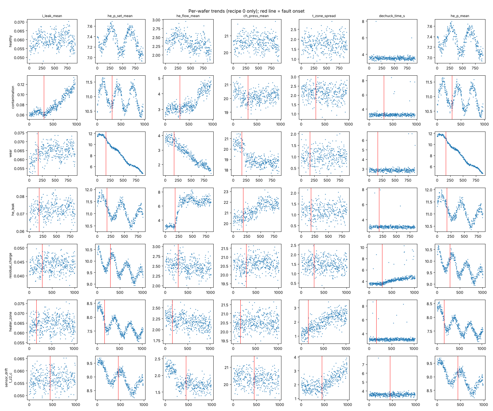
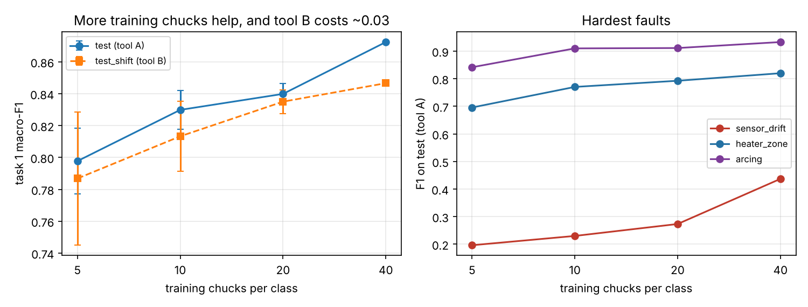

# ESC-Fault: a simulated benchmark for electrostatic chuck fault diagnosis

[](https://doi.org/10.5281/zenodo.24185993)

A free, open benchmark for diagnosing faults in the **electrostatic chuck (ESC)**, the part of a
semiconductor etch or deposition tool that holds the wafer with static electricity and cools it with
backside helium.

Real equipment data stays inside chipmakers and toolmakers, so public fault benchmarks for fab tools are
rare. This dataset is **simulated** from simplified physics, with every constant either taken from a
public source or marked as an assumption (see [DATASET_CARD.md](DATASET_CARD.md)).

- 140 simulated chucks, about 125,000 wafers, 14 sensor signals at 1 Hz per wafer
- 6 fault types plus healthy, including a **sensor-fault decoy** (the sensor is wrong, the chuck is fine)
- 3 tasks: diagnose, detect early, predict remaining life
- Held-out test labels: the test chucks come from a private seed



## New: v2 (multi-fault, tool shift, data-size study)

v2 is a separate, larger release; v1 below is unchanged. Details in [DATASET_CARD.md](DATASET_CARD.md#dataset-card-esc-fault-v2).

- 552 chucks, about 490,000 wafers: 40 chucks per class in train, 10 per class in test (4x v1)
- New fault `arcing`; two faults at once on some chucks (task 1 becomes multi-label); intermittent helium
  leaks; slow onsets; a recipe that appears mid-life with no reference wafers
- `test_shift`: chucks from a second tool profile (other recipes, hardware and sensor noise)
- Generator options so anyone can make more training data: `python generate2.py --per-class 100 --seed 1`

| v2 baseline (gradient-boosted trees, `baselines2.py`) | val | test (tool A) | test_shift (tool B) |
| --- | --- | --- | --- |
| Task 1 macro-F1 over 7 faults | 0.902 | 0.872 | 0.847 |
| Task 1 exact match (all faults right) | 0.890 | 0.864 | 0.815 |
| Task 1 healthy windows wrongly flagged | 0.3% | 2.4% | 5.4% |
| Task 2 detection rate / median delay (wafers) | 95% / 77 | 94% / 85 | 93% / 83 |
| Task 2 false alarms per 1,000 healthy wafers | 0.11 | 0.11 | 0.21 |
| Task 3 remaining-life MAE (wafers); guess-the-mean | 60.2; 117.7 | 55.8; 125.8 | 69.7; 115.9 |



What the data-size study shows (same model trained on 5, 10, 20 or 40 chucks per class, 3 random subsets
below 40): task-1 macro-F1 on test rises from 0.80 to 0.87, and the second tool costs about 0.03 at every
size. `sensor_drift` stays the hardest fault (test F1 0.20 at 5 chucks per class, 0.44 at 40): telling a
drifting sensor from a failing chuck does not go away with more data. Validation scores it 0.78 because half of its
8 sensor-drift chucks are helium-pressure drifts, which break an obvious consistency check; in the test set
only 4 of 16 are, and several of the others are small or on chucks with a second fault. Per-sub-type scores are the next thing to report.

v2 files are on [Hugging Face](https://huggingface.co/datasets/forgottenl5/esc-fault-benchmark) under `v2/`
(tables for all splits, raw signals for test and test_shift; rebuild train/val raw signals with
`python generate2.py --splits train,val --raw`).

```bash
python generate2.py --out data_v2 --splits train,val          # exact rebuild, about 25 s
python make_tasks2.py --data data_v2 --out tasks_v2 --splits train,val
python baselines2.py --data data_v2 --tasks tasks_v2 --eval val
python tests/test_reproducible_v2.py
```

The rest of this page describes v1.

## Fault classes

| Fault | Physical cause | Main signature |
| --- | --- | --- |
| `contamination` | Conductive film on the chuck surface | Leakage current rises, clamping weakens, helium flow rises; runs to end of life |
| `wear` | Surface wears smooth, more wafer contact | Helium pressure needed to hold wafer temperature falls; runs to end of life |
| `he_leak` | Seal or seating problem behind the wafer | Helium flow and chamber pressure rise |
| `residual_charge` | Charge stays after voltage is removed | Release (dechuck) time grows, more sticking events |
| `heater_zone` | One heater zone loses control | Zone temperature spread widens; helium setpoint shifts |
| `sensor_drift` | One sensor drifts; the chuck is fine | One reading drifts while related signals stay consistent |

Normal events that are **not** faults also appear in every chuck: plasma cleans, post-clean "seasoning",
small sensor recalibrations, coolant drift, recipe changes and slow normal wear.

## Files

| Path | Contents |
| --- | --- |
| `data_small/wafers_{train,val,test}.parquet` | One row per wafer: recipe, counters, release time and 15 summary features |
| `data_small/labels_{train,val}.parquet` | Per wafer: fault, severity (0 to 1), remaining life |
| `data_small/chucks_{train,val}.json` | Per chuck: fault, onset wafer, length, fault size |
| `data_small/timeseries_sample_train.parquet` | Raw 1 Hz signals for 2 training chucks |
| `tasks/` | Task files for all splits (test files have no answers) |
| `notebooks/esc-fault-starter.ipynb` | Starter notebook: features, random forest for tasks 1 and 3, validation scores, test prediction files (runs as is on Kaggle or locally) |
| Full raw time series (about 500 MB compressed) | [Hugging Face: forgottenl5/esc-fault-benchmark](https://huggingface.co/datasets/forgottenl5/esc-fault-benchmark), or rebuild train/val with `generate.py` |

Raw signals: `v_set, v_rb, i_leak_ma, he_p_set_torr, he_p_torr, he_flow_sccm, t_wafer_c, t_z1_c..t_z4_c,
t_cool_c, rf_power_w, ch_press_mtorr`. Each wafer is 90 s: clamp at 2 s, helium at 5 s, RF from 10 to
80 s, release at 85 s.

## Tasks

All tasks are **causal**: a prediction at wafer *n* may use only wafers 0 to *n* of that chuck. The
first 100 wafers of every chuck are healthy and may be used as its reference.

| Task | Question | Score |
| --- | --- | --- |
| 1. Diagnose | For each (chuck, end wafer): which of the 7 classes? Faulty once severity is at least 0.15 | Macro-F1 |
| 2. Detect early | One alarm per chuck, with the fault type | Detection rate, median delay in wafers, false alarms per 1,000 healthy wafers |
| 3. Remaining life | For chucks that wear out: wafers left after the end wafer | Mean absolute error; asymmetric score that penalizes late (too optimistic) guesses more |

The test task-3 file also contains decoy rows on chucks that do not wear out, so it does not leak
task-1 answers. Decoys are not scored.

## Baseline results (test set, 28 chucks)

| Model | Task 1 macro-F1 | Task 2 detection | Task 2 median delay | Task 2 false alarms / 1k | Task 3 MAE (wafers) |
| --- | --- | --- | --- | --- | --- |
| Threshold rules | 0.667 | 87.5% | 152 | 0.00 | n/a |
| Random forest | 0.812 | 83.3% | **73** | 0.17 | **65.5** |
| Random forest + trend and consistency features (`baseline_features2.py`) | **0.861** | not run | not run | not run | not run |
| Small neural net (MLP) | 0.782 | 83.3% | 74.5 | 0.17 | n/a |
| Guess the mean | n/a | n/a | n/a | n/a | 123.4 |

Per-class task-1 F1 (test): the original random forest scores heater_zone 0.57 and sensor_drift 0.23; with the
extended features they are 0.73 and 0.43, and every other class is 0.95 or higher. Telling a failing sensor from a
failing chuck is still the hard part, but the test set has only 4 chucks per class, so these per-class numbers are
noisy. A separate development run with 60 chucks per class (not released) gave the original random forest 0.61 on
sensor_drift in cross-validation and 0.73 for gradient boosting with the extended features, so part of the low score
here is too few training chucks: sensor_drift has 14 training chucks spread over 7 sub-types (4 sensors, 4 zones).

## Quick start

```bash
pip install -r requirements.txt
python generate.py --out data --splits train,val     # rebuild train/val exactly (about 15 s)
python make_tasks.py --data data --out tasks --splits train,val
python baselines.py --data data --tasks tasks --eval val
python baseline_features2.py --data data --tasks tasks --eval val   # task 1 with extended features
python tests/test_reproducible.py                     # checks the rebuild matches the published files
```

The per-wafer tables in `data_small/` are enough for all three tasks. Raw time series are optional.

## Submitting test results

Run your model on the test task files and open an issue with three CSVs (formats in `score.py`):
`task1: chuck_id,end_wafer,label`, `task2: chuck_id,alarm_wafer,fault`, `task3: chuck_id,end_wafer,rul_pred`.
Results will be scored against the held-out answers and added to a leaderboard here.

## Limits

This is simulated data from a lumped model, not measurements from a real tool. Several constants are
assumptions, listed in the dataset card. Good scores here show a method can separate these fault
patterns; they do not prove it will work on a real chuck. Corrections from people who work with ESCs are
welcome; please open an issue.

## How to cite

Use GitHub's "Cite this repository" button (from `CITATION.cff`), or:

```bibtex
@misc{escfault2026,
  title  = {ESC-Fault: a simulated benchmark for electrostatic chuck fault diagnosis},
  author = {forgottenl5},
  year   = {2026},
  url    = {https://github.com/forgottenl5/esc-fault-benchmark},
  note   = {Version 2.0.1},
  doi    = {10.5281/zenodo.24185993}
}
```

## License

Code: MIT. Data: CC BY 4.0. Author: forgottenl5.
