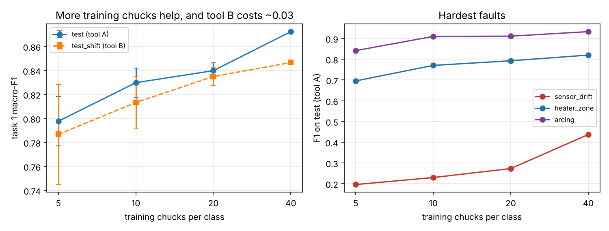

# A fault model scored 0.90 on validation and still missed most sensor drift

*forgottenl5, November 2026*

I built an open, simulated benchmark for diagnosing faults in an electrostatic chuck (ESC), the part that holds a wafer in a semiconductor etch or deposition tool. Then I trained the obvious baseline on it. The headline number looked great. The details did not.

Data: https://huggingface.co/datasets/forgottenl5/esc-fault-benchmark · DOI 10.5281/zenodo.24185993

## What is in it

A lumped-physics simulator generates per-wafer signals for many chucks: leakage current, clamp force, backside helium flow and pressure, four heater-zone temperatures, release time. Seven faults can appear, alone or two at a time: contamination, wear, helium leak, residual charge, heater-zone failure, arcing, and sensor drift. Sensor drift is a decoy. The equipment is fine, one sensor is lying. Telling that apart from a real fault is the point.

Three tasks, all causal (a model sees only the past): diagnosis from a window of wafers, early detection with a false-alarm budget, and remaining life. Test labels are private, and the test set includes a second tool with different calibration.

It is a simulation. It cannot say how well a model works on a real fab; it can say which methods fall apart when faults overlap, sensors lie, or the tool changes.

## The baseline

One gradient-boosted classifier per fault, on features built from each chuck's own reference period (its first 100 wafers). Macro-F1 over the seven faults:

| Split | Macro-F1 |
|---|---|
| Validation | 0.902 |
| Test | 0.872 |
| Test, second tool | 0.847 |

That is a decent score. Per fault it is more interesting: contamination, wear and residual charge are close to solved (0.98 to 1.00 on test). Sensor drift is 0.776 on validation and 0.437 on test.

## Part of that gap is small samples

Sensor drift has few chucks per split, and which sensor drifts matters a lot. A helium-pressure sensor drifting is easy to spot (the controller fights it and the flow changes). A zone-temperature sensor drifting is nearly invisible: recall was 0.11 on test and 0.00 on the second tool.

I ran a data-size study to see whether more training chucks would fix it: 5, 10, 20 and 40 chucks per class, three random draws each, scored on all three splits. Macro-F1 climbs with data, but sensor drift swings wildly at small sizes (on validation it went from 0.25 to 0.78 depending on draw and size). With so few drifting chucks, a single number tells you very little. 

## "Maybe the features throw away the signal"

Fair objection. My features are summaries. So I rebuilt the raw signals and gave the trees the full shape of each 90-second step: 30 blocks across 11 signals, as deviation from the chuck's own reference, plus change over time.

Result: macro-F1 moved by +0.000 on validation, +0.003 on test and +0.005 on the second tool, which is noise at 28 test chucks. The raw shapes alone do worse overall (0.64) because residual charge and arcing live in spikes and release behaviour, not in mean shape. And zone-temperature drift stayed at 0.06 recall.

So the bottleneck is not feature resolution. A drifting zone-temperature sensor may carry too little information for these model families on this data. I do not know whether a model that uses cross-zone physics could find it. That is the part I would like someone to try.

## Mistakes worth admitting

My first v1 scores for sensor drift and heater zone looked terrible, and I initially read that as hard faults. Mostly it was a tiny sample. I also wrote a "when it was missed" column in a table from memory before checking it per sensor; part of it was wrong, and I corrected it before publishing. Check per-subgroup numbers before you explain them.

## Try it

The [v2 starter notebook](../notebooks/esc-fault-v2-starter.ipynb) loads the Hugging Face files, trains the baseline, scores it on validation and writes test predictions.

If you beat the zone-temperature drift number, or find a way the benchmark is unfair, open an issue. Test predictions are scored by the maintainer (instructions in the README).
